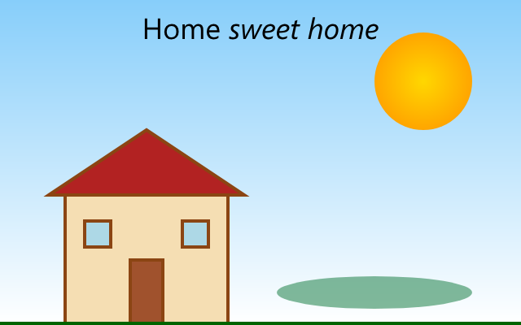
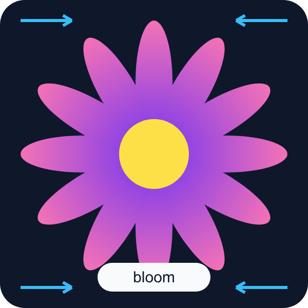
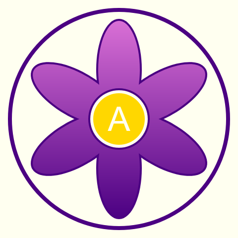
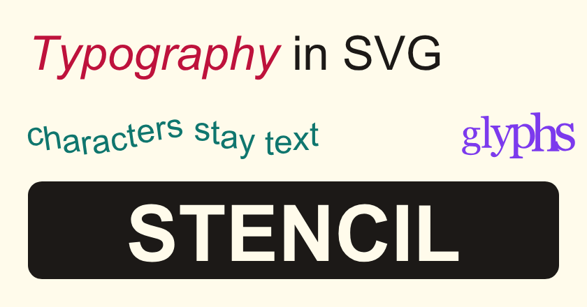
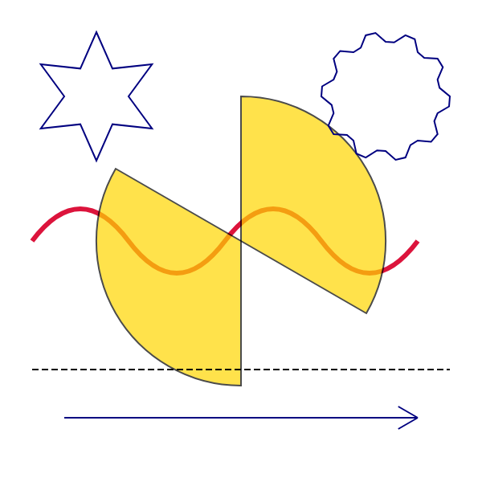
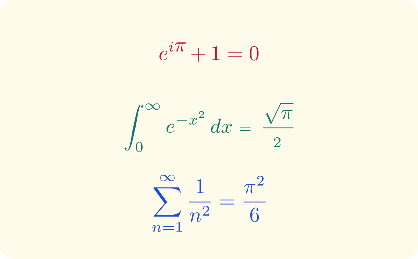
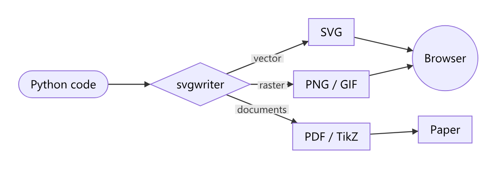

# svgwriter

[](https://github.com/wzjoriv/svgwriter/actions/workflows/ci.yml)
[](https://wzjoriv.github.io/svgwriter)
[](https://pypi.org/project/pysvgwriter/)
[](https://pypi.org/project/pysvgwriter/)
[](https://github.com/wzjoriv/svgwriter/actions/workflows/ci.yml)
[](https://github.com/wzjoriv/svgwriter/actions/workflows/ci.yml)
[](LICENSE)

Build, edit and render vector graphics in Python with a complete SVG 1.1 object model. Shapes move,
rotate and scale through one transform; geometry has boolean operations and measurement; text, images
and colors are first-class (numpy-backed); documents render with skia and export to PNG, PDF, TikZ, DXF
and more. Python 3.10+, `pip install pysvgwriter` (brings skia-python, numpy and uharfbuzz), then `import svgwriter`.

```python
import svgwriter as svg

doc = svg.Document()                                    # sized to its content when saved or shown
doc.rect(0, 0, 160, 60, rx=12, fill=svg.LinearGradient.horizontal("gold", "tomato"))
doc.circle(30, 30, 18, fill=(1, 1, 1, 0.8))             # colors: names, CSS, or 0-1 tuples (alpha too)
title = doc.text("svgwriter", x=88, y=36, font_size=18, text_anchor="middle")
title[3:].fill = "navy"                                  # style a character range (becomes a <tspan>)

star = svg.builder.star(0, 0, 10, points=5, fill="navy")
doc += star.place(30, 30).rotate(15)                    # placement and rotation go through `t`

doc.save("badge.svg")                                    # also .png .pdf .tex .eps .dxf .ico ...
pixels = doc.rasterize(scale=2)                          # numpy float32 RGBA, shape (rows, cols, 4)
```

## Feature overview

| Area | What you get |
| --- | --- |
| Elements | Every static SVG 1.1 element as a class with a lowercase alias (`svg.Circle` / `svg.circle`); every attribute readable and writable by its Python name (`el.stroke_width`, `el.view_box`) |
| Placement | `el.t` is one affine `Matrix`; `translate`, `rotate`, `scale`, `skew`, `flip_x`/`flip_y` (parent or `local=True` frame) about an `anchor` (bounding-box centre unless pinned); `place(x, y)`, `position`, `bounds()` |
| Operators | `el + (dx, dy)`, `el * 2`, `el @ 30` (rotate), `M @ el`; `a \| b`, `a & b`, `a - b`, `a ^ b` boolean ops on shapes, text, groups and `<use>` |
| Paths | Fluent `svg.path().move_to(0, 0).line_to(10, 0).arc_to(5, 5, 10, 10).close()`; `path.nodes` as an `(N, 2)` array; length, point at length, contains, exact bounds, stroke-to-path, simplify |
| Conversions | `to_path()` (text via glyph outlines, groups merged, clips flattened), `to_image()`, `rasterize()`, `to_group()`, `clone(linked=True)` for `<use>`; clear errors when impossible |
| Clipping | `art.clip(svg.circle(50, 50, 40))` on any element; `flatten_clip()` |
| Text | `text[i]` / `text[a:b]` move, rotate or style characters while staying real text; `tspan` layout, CSS and inherited fonts; `text.glyphs()` for free-form outlines |
| Colors and images | `Color` in 0-1 floats with alpha (auto `*-opacity`); `Image(numpy_array)` with color channels and broadcastable alpha; `Image.open("photo.png")`; Porter-Duff compositing `a \| b` (over), `a & b` (in), `a - b` (out), `a ^ b`, `a * b` (multiply), `a.composite(b, "screen")` |
| Documents | `doc[0]`, `doc["logo"]`, `for el in doc`; auto-size to content; definitions land in `<defs>` when referenced; `doc.add(x)` takes elements, documents, matplotlib figures and anything with `__svgwriter__`, `_repr_svg_`, `_repr_png_` or `_repr_jpeg_` (see [Adding other objects](#adding-other-objects)); notebook display |
| Rendering | skia: `rasterize(size=..., padding=...)` to numpy, embedded and linked images, text, CSS `<style>`; deterministic output |
| Export / import | A registry by name or extension: more than 30 formats from SVG and PNG to PDF, TikZ, DXF, G-code, PowerPoint, Graphviz and Mermaid (see [Export and import](#export-and-import)); `svg.export.register(...)` adds more |
| Animation | SMIL elements; `doc.render_animation("out.mp4", update=...)` through ffmpeg; `svg.interpolate(a, b, t)` tweens numbers, colors, transforms and morphs any two shapes |

## Geometry in one minute

SVG coordinates are an element's own geometry and are written exactly as given; everything after that
goes through the transform, so the output stays the SVG a person would write.

```python
import svgwriter as svg

c = svg.circle(50, 50, 10)          # writes cx="50" cy="50" r="10"
c.translate(20, 0).rotate(45)       # parent axes by default; local=True for the shape's own axes
print(c.cx, c.position)             # 50.0 (local geometry) and where its centre is now: (70, 50)
print(c.t)                          # shortest equivalent transform text

ring = svg.circle(0, 0, 40) - svg.circle(0, 0, 25)   # boolean difference, a <path>
print(round(ring.total_length(), 1), ring.contains_point(0, 0))
```

`*` and `@` never bake coordinates: `el * 2` is a scaled copy, `el @ 30` a rotated copy and `M @ el` a
copy with matrix `M` applied. Baking is explicit: `el.to_path()` folds the transform into `d`.

## Adding other objects

`doc.add(x)` (and `group.add(x)`) turns whatever it is given into elements, trying in this order: an
element; any object with an `__svgwriter__()` method, which returns an element, a document or anything
else `add` takes; a `Document` (a copy of its `<svg>` in a `<g>`); a networkx graph (with
`pysvgwriter[graph]`); a numpy array (an `<image>`); a matplotlib figure or anything with `savefig`, and
anything with `_repr_svg_` (the IPython display protocol), parsed into editable SVG elements; and
anything with only `_repr_png_` or `_repr_jpeg_`, embedded as an `<image>`.

```python
class Badge:
    def _repr_svg_(self):
        return '<svg xmlns="http://www.w3.org/2000/svg" width="20" height="20"><circle cx="10" cy="10" r="9"/></svg>'

doc.add(Badge()).translate(150, 10).scale(0.5)          # also: doc.add(fig) for a matplotlib figure
```

## Export and import

Formats are found by name or file extension: `doc.save("figure.pdf")`, `svg.Document.open("figure.pdf")`,
`doc.export("eps")` for bytes. `svg.export.exporters()` and `svg.export.importers()` list the registry.

| Format | Extension(s) | Export | Import | Notes |
|---|---|:---:|:---:|---|
| SVG | `.svg` | ✓ | ✓ | the native format; ids, links, `<style>` and animation kept; `pretty`, `precision`, `compact_paths` |
| SVGZ | `.svgz` | ✓ | ✓ | gzip-compressed SVG |
| PNG | `.png` | ✓ | ✓ | `scale`, `size`, `padding`, `background`; text becomes pixels; import is an `<image>` |
| JPEG | `.jpg` `.jpeg` | ✓ | ✓ | `quality`; import is an `<image>` |
| WebP | `.webp` | ✓ | ✓ | `quality`; import is an `<image>` |
| BMP | `.bmp` | ✓ | ✓ | import is an `<image>` |
| GIF (incl. animated) | `.gif` | ✓ | ✓ | animated automatically when the drawing has SMIL animation (`fps`, `duration`, `loop`; no ffmpeg); import is the first frame as an `<image>` |
| APNG | `.png` | ✓ | ✓ | `animate=True` plays the SMIL animation; import is the first frame |
| Animated WebP | `.webp` | ✓ | ✓ | `animate=True`; import is the first frame |
| PPM / PGM / PNM | `.ppm` `.pgm` `.pnm` | ✓ | ✓ | import also reads `.pbm` |
| ICO | `.ico` | ✓ | ✓ | PNG entries at `sizes=`, `padding=`; import takes the largest image |
| ICNS | `.icns` | ✓ | ✓ | standard and Retina sizes; import takes the largest image |
| PDF | `.pdf` | ✓ | ✓ | vector (skia); text kept as text, in an embedded font subset; import reads paths, images, clips, text and shadings, `page=` |
| EPS / PostScript | `.eps` `.ps` | ✓ | ✓ | text kept as text (ASCII in standard fonts); no transparency; import is a small PostScript interpreter |
| TikZ | `.tikz` `.tex` | ✓ | ✓ | `standalone=True` for a compilable document; text kept as `\node`; import reads `\draw`, `\fill`, nodes, `\foreach` |
| DXF | `.dxf` | ✓ | ✓ | CAD polylines in mm, one layer per colour; import reads lines, polylines, circles, arcs, ellipses |
| HPGL | `.hpgl` `.plt` | ✓ | ✓ | pen plotters and cutters, one pen per colour |
| G-code | `.gcode` `.nc` `.ngc` | ✓ | ✓ | `mode="mill"` or `"laser"`, `feed`, `cut_z`, `tolerance` |
| Excalidraw | `.excalidraw` | ✓ | ✓ | import reads shapes, arrows, text, images and groups (also `.json`) |
| HTML | `.html` `.htm` | ✓ | ✓ | standalone page with the SVG inline (text kept as text), `css=`, `handlers=`; import reads the first inline `<svg>` |
| PowerPoint | `.pptx` | ✓ | ✓ | needs `pysvgwriter[office]`; editable shapes and text boxes both ways, `slide=` on import; text kept as text |
| Word | `.docx` | ✓ | ✓ | needs `pysvgwriter[office]`; export is a picture, import reads pictures and drawn shapes (no text) |
| Excel | `.xlsx` | ✓ | — | needs `pysvgwriter[office]`; the drawing as a picture |
| Markdown | `.md` `.markdown` | — | ✓ | headings, lists, code and bold become `<text>` |
| Plain text | `.txt` `.text` | — | ✓ | one `<text>` per line |
| Graphviz DOT | `.dot` `.gv` | — | ✓ | laid out by Graphviz (`dot`, or `SVGWRITER_DOT`) |
| Mermaid | `.mmd` `.mermaid` | — | ✓ | flowcharts need no tool (built-in parser and layout); other diagrams use `mmdc` (`SVGWRITER_MMDC`) |
| PlantUML | `.puml` `.plantuml` | — | ✓ | drawn by `plantuml` |
| D2 | `.d2` | — | ✓ | drawn by `d2` |
| LaTeX math | `svg.latex(...)` | — | ✓ | formulas as glyph outlines: TeX (`latex` + `dvisvgm`), else Ziamath (`pysvgwriter[math]`), else matplotlib mathtext |
| Video frames | `.mp4` `.webm` `.mov` | ✓ | ✓ | needs ffmpeg: `render_animation` writes frames, `svgwriter.video.Video` reads them |

`svg.export.register(...)` and `register_importer(...)` add formats of your own.

```python
doc.save("figure.pdf")                         # vector PDF
doc.save("figure.tex", standalone=True)        # TikZ picture
doc.save("plate.dxf")                          # CAD/CNC polylines in millimetres
doc.save("icon.ico", sizes=(16, 32, 48), padding=4)
svg.Document.open("sketch.excalidraw").save("sketch.svg")
```

## Examples

[`examples/`](https://github.com/wzjoriv/svgwriter/tree/main/examples) is a twelve-step learning path, from shapes to formats, animation, interop and a logo; each step is a runnable script with a Jupyter notebook next to it that shows the results as pictures (see its [README](https://github.com/wzjoriv/svgwriter/blob/main/examples/README.md)). All pictures below are rendered by svgwriter.

| | | |
|:---:|:---:|:---:|
| [](https://github.com/wzjoriv/svgwriter/blob/main/examples/01_basic_shapes.ipynb)<br>[Shapes, gradients, text](https://github.com/wzjoriv/svgwriter/blob/main/examples/01_basic_shapes.ipynb) | [](https://github.com/wzjoriv/svgwriter/blob/main/examples/02_transforms_and_layout.ipynb)<br>[Transforms](https://github.com/wzjoriv/svgwriter/blob/main/examples/02_transforms_and_layout.ipynb) | [](https://github.com/wzjoriv/svgwriter/blob/main/examples/03_paths_and_geometry.ipynb)<br>[Boolean operations](https://github.com/wzjoriv/svgwriter/blob/main/examples/03_paths_and_geometry.ipynb) |
| [](https://github.com/wzjoriv/svgwriter/blob/main/examples/04_typography.ipynb)<br>[Typography](https://github.com/wzjoriv/svgwriter/blob/main/examples/04_typography.ipynb) | [](https://github.com/wzjoriv/svgwriter/blob/main/examples/05_paint_and_filters.ipynb)<br>[Filter effects](https://github.com/wzjoriv/svgwriter/blob/main/examples/05_paint_and_filters.ipynb) | [](https://github.com/wzjoriv/svgwriter/blob/main/examples/03_paths_and_geometry.ipynb)<br>[Paths and markers](https://github.com/wzjoriv/svgwriter/blob/main/examples/03_paths_and_geometry.ipynb) |
| [](https://github.com/wzjoriv/svgwriter/blob/main/examples/09_animation.ipynb)<br>[Animation presets](https://github.com/wzjoriv/svgwriter/blob/main/examples/09_animation.ipynb) | [](https://github.com/wzjoriv/svgwriter/blob/main/examples/08_math_and_diagrams.ipynb)<br>[LaTeX math](https://github.com/wzjoriv/svgwriter/blob/main/examples/08_math_and_diagrams.ipynb) | [](https://github.com/wzjoriv/svgwriter/blob/main/examples/08_math_and_diagrams.ipynb)<br>[Mermaid flowchart](https://github.com/wzjoriv/svgwriter/blob/main/examples/08_math_and_diagrams.ipynb) |

Regenerate the pictures (PNG, and the animation as GIF) with `python scripts/dev.py svgwriter gallery`.

## Development

```
pip install -e ".[dev]"
python scripts/dev.py test                     # test tiers
python scripts/dev.py check                    # ruff, tests, docs
python scripts/dev.py stub generate            # build the .pyi stubs locally (git-ignored; the release workflow builds the shipped ones)
python scripts/dev.py svgwriter conformance    # W3C SVG 1.1 suite (after: svgwriter fetch-suite)
python scripts/dev.py svgwriter bench          # timing of the hot paths
```

MIT licensed.
