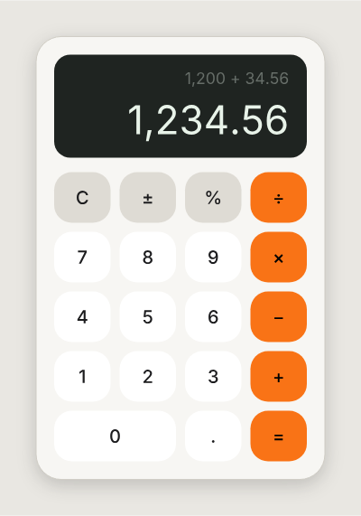

# Calculator kit



A calculator UI built from layout groups, with a control for every design decision: the shell style
(default, flat, brutal, soft, glass), the key shape (sharp, rounded, round, pill, circle), the layout
(standard 4x5, scientific 5x6, compact 4x4), the display font, size and alignment, the history line, the
key font and weight, the spacing (padding, key gap, key height, corner radius, width) and the accent
palette.

What it shows:

- `VStack`, `HStack` and `Grid`: each key sizes itself, the keypad sizes itself to the keys (the zero key
  spans two columns), and the shell to the display and the keypad, so any control re-lays out everything.
- `@svg.widgets.controls` with `Segmented`, `Slider`, `Toggle` and `Swatches`.
- The theme (`theme.toml`) for the neutral colours and fonts, filters for the shell shadows, and a project
  animation preset (`animations/press.py`) that presses the `=` key in the SVG.

Every parameter of `calculator` is a control, so `svgwriter preview` and `svg.explore` offer them all; the notebook also shows stills of the glass, brutal and soft shells.

Open the notebook, [calculator-kit.ipynb](calculator-kit.ipynb), to see the demo step by step with its pictures; run it to get a panel for the controls.

```
svgwriter preview    # the calculator with its controls, live
svgwriter build      # output/calculator-kit.{svg,png,pdf}
```
