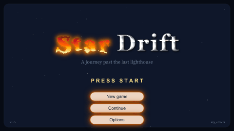

# Effects



A retro game title screen: **Star Drift** in big letters, the first word on fire and the second in polished
metal, a "Press start" prompt that blinks forever, and a menu of glowing buttons that dim under the pointer and
flash when clicked (in the SVG).

What it shows:

- `svg.effects` on ranges of a line: `title[start:end].effect("fire")` styles only those letters, and the
  title stays live, selectable text.
- `element.effect("neon")` on shapes: each menu button, the effect sized to the button.
- `button.interact.button()` for hover and click, and the project's `twinkle` animation for the blinking
  prompt and the stars.
- SMIL animation: the SVG plays in a browser, and the same document renders to a GIF.
- The theme (`theme.toml`), a component (`components/card.py`, the starry card) and a project animation preset
  (`animations/twinkle.py`).

Controls (`svgwriter preview` shows them as a form): the `title` text, and dropdowns for the effect of the
`first word`, the `second word` and the `buttons`, picked from `svg.effects`.

Open the notebook, [effects.ipynb](effects.ipynb), to see the demo step by step with its pictures; run it to get a panel for the controls.

```
svgwriter preview    # the animated SVG and the GIF
svgwriter build      # output/effects.svg and output/effects.gif
```

The GIF renders every frame with filters, so it takes a minute or so; lower `fps` in `svgwriter.toml` for
a quicker draft.
