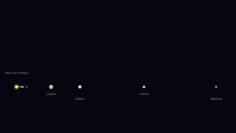

# Planets explainer



A four-slide classroom lesson on the Solar System, written as `Scene` classes:

1. **Title**: "The Solar System" and the lesson's three goals, fading in one by one.
2. **Eight planets**: the orbits drawn to scale (1 AU = 36 px) while each planet circles the Sun.
3. **700× wider**: the Sun beside Betelgeuse, with a row of 100 Suns counted on a rolling counter.
4. **Quiz**: three questions on cards; each answer appears when its card is clicked.

What it shows:

- `svg.Scene` classes, a project behaviour (`animations/orbit.py`) and per-frame `update`.
- One PowerPoint deck for all scenes (`pptx = { deck = true }` in `svgwriter.toml`): animations become slide
  effects, and the quiz answers use click triggers (`animate.on("click", card)`).
- Baking: the SVG of each slide plays in a browser like the video.
- Components for the heading, the planet table (`assets/data`) and the counter.

Controls (`svgwriter preview` shows them as a form): which `scene` to show and a `time scale`.

Open the notebook, [planets-explainer.ipynb](planets-explainer.ipynb), to see the demo step by step with its pictures; run it to get a panel for the controls.

```
svgwriter preview                # every output, playing
svgwriter build                  # output/planets-explainer-<Scene>.{mp4,svg,pptx}; needs ffmpeg for MP4
svgwriter build --format gif     # without ffmpeg: a GIF per scene
python main.py                   # MP4 when ffmpeg is installed, else GIF, plus SVG and PPTX
```

PowerPoint needs the office extra: `pip install pysvgwriter[office]`.
