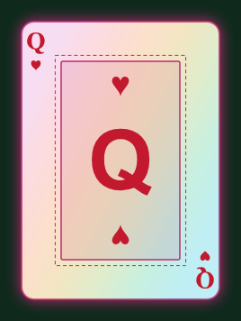
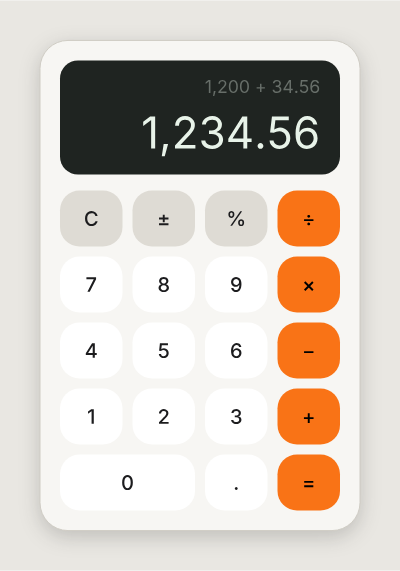
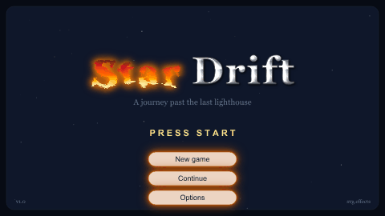

# Demos

The [`demos/`](https://github.com/wzjoriv/svgwriter/tree/main/demos) folder holds complete design projects.
Each one is an ordinary project, as `svgwriter new` makes them: `svgwriter.toml`, `main.py`, `theme.toml`,
`components/`, `animations/` and `assets/`, and each uses several features together. Open a demo's folder
and run `svgwriter preview` to see it live (with its controls, where it has them), or `svgwriter build` to
write its outputs into `output/`. The [`examples/`](https://github.com/wzjoriv/svgwriter/tree/main/examples)
stay short scripts about one topic each; see {doc}`guides/projects` for how projects work.

Every demo also has a Jupyter notebook beside its `main.py`, named after the demo (`<name>/<name>.ipynb`), that
shows the code cell by cell with pictures, a panel for the demo's controls when run, and stills for other
values. `python scripts/dev.py svgwriter demo-notebooks build` writes them.

## Playing card

[`demos/playing-card`](https://github.com/wzjoriv/svgwriter/tree/main/demos/playing-card): a card with
rank and suit buttons, hue, iridescence, glow, corner radius and width controls
(`@svg.widgets.controls`), corner indices, pips and court panels built from layout groups, and a sweep of
the same parameters written as a GIF. Outputs: SVG, PNG, PDF and GIF. [Notebook](https://github.com/wzjoriv/svgwriter/blob/main/demos/playing-card/playing-card.ipynb).

## Calculator kit

[`demos/calculator-kit`](https://github.com/wzjoriv/svgwriter/tree/main/demos/calculator-kit): a calculator
UI from `VStack`, `HStack` and `Grid`, with controls for the shell style, key shape, keypad layout, display
font, size and alignment, history line, key font and weight, spacing and palette. Outputs: SVG, PNG and PDF. [Notebook](https://github.com/wzjoriv/svgwriter/blob/main/demos/calculator-kit/calculator-kit.ipynb).

## Effects

[`demos/effects`](https://github.com/wzjoriv/svgwriter/tree/main/demos/effects): a retro game title screen
whose two title words carry their own effects (still selectable text), a blinking "Press start" and menu
buttons that glow and respond to hover and click, with controls for the title and each effect. Outputs: an
animated SVG and a GIF. [Notebook](https://github.com/wzjoriv/svgwriter/blob/main/demos/effects/effects.ipynb).

## Planets lesson

[`demos/planets-explainer`](https://github.com/wzjoriv/svgwriter/tree/main/demos/planets-explainer): a four-slide
classroom lesson on the Solar System as `Scene` classes: a title slide with the lesson's goals, the planets'
orbits to scale, the Sun beside Betelgeuse with 100 Suns counted up, and a quiz whose answers appear when their
question is clicked. Outputs: a video, an animated SVG per slide and one PowerPoint deck
(`pptx = { deck = true }`) with slide effects and click triggers for the quiz. [Notebook](https://github.com/wzjoriv/svgwriter/blob/main/demos/planets-explainer/planets-explainer.ipynb).

## Blobs

[`demos/blobs`](https://github.com/wzjoriv/svgwriter/tree/main/demos/blobs): a website hero banner: a headline
and a "Get started" button (hover and click in the SVG) beside metaballs that merge and split under the goo filter, moved by a project behaviour on a seamless loop, with controls for the number of blobs, their gooeyness, the speed, the headline and the button text. Outputs: GIF and animated SVG. [Notebook](https://github.com/wzjoriv/svgwriter/blob/main/demos/blobs/blobs.ipynb).

## Poster

[`demos/poster`](https://github.com/wzjoriv/svgwriter/tree/main/demos/poster): an A4 print poster drawn in
millimetres: an invitation to a beach clean-up with gradients, patterns, a route with markers, drawn icons of what to bring and a schedule read from CSV, and controls for the theme, an accent hue shift and the event's title, date, time and place. Outputs: a true-size
PDF, a 300 dpi PNG and an SVG. [Notebook](https://github.com/wzjoriv/svgwriter/blob/main/demos/poster/poster.ipynb).

Each demo's `output/` folder holds its built SVG, PDF, PNG and PowerPoint files, so you can open the results
without running anything (`python scripts/dev.py svgwriter demo-outputs build` rebuilds them). The pictures on this page are built from the demos by `python scripts/dev.py svgwriter gallery`.
