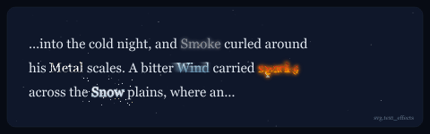
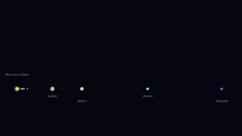
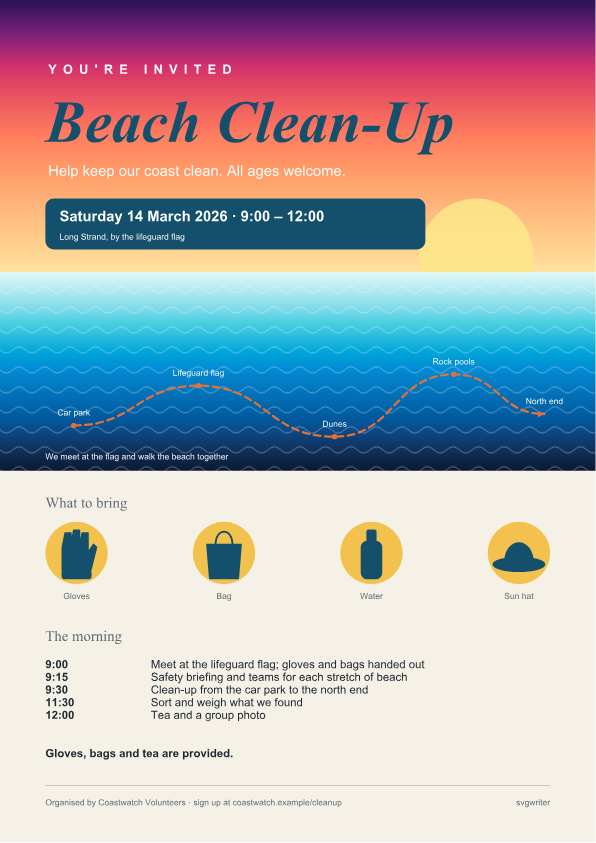

# Demos

The [`demos/`](https://github.com/wzjoriv/svgwriter/tree/main/demos) folder holds complete design projects.
Each one is an ordinary project, as `svgwriter new` makes them: `svgwriter.toml`, `main.py`, `theme.toml`,
`components/`, `animations/` and `assets/`, and each uses several features together. Open a demo's folder
and run `svgwriter preview` to see it live (with its controls, where it has them), or `svgwriter build` to
write its outputs into `output/`. The [`examples/`](https://github.com/wzjoriv/svgwriter/tree/main/examples)
stay short scripts about one topic each; see {doc}`guides/projects` for how projects work.

Every demo also has a Jupyter notebook beside its `main.py`, named after the demo (`<name>/<name>.ipynb`), that
shows the code cell by cell with pictures, a panel for the demo's controls when run, and stills for other
values. `python scripts/dev.py svgwriter demo-notebooks build` writes them.

## Playing card

[`demos/playing-card`](https://github.com/wzjoriv/svgwriter/tree/main/demos/playing-card): a card with
rank and suit buttons, hue, iridescence, glow, corner radius and width controls
(`@svg.widgets.controls`), corner indices, pips and court panels built from layout groups, and a sweep of
the same parameters written as a GIF. Outputs: SVG, PNG, PDF and GIF. [Notebook](https://github.com/wzjoriv/svgwriter/blob/main/demos/playing-card/playing-card.ipynb).

## Calculator kit

[`demos/calculator-kit`](https://github.com/wzjoriv/svgwriter/tree/main/demos/calculator-kit): a calculator
UI from `VStack`, `HStack` and `Grid`, with controls for the shell style, key shape, keypad layout, display
font, size and alignment, history line, key font and weight, spacing and palette. Outputs: SVG, PNG and PDF. [Notebook](https://github.com/wzjoriv/svgwriter/blob/main/demos/calculator-kit/calculator-kit.ipynb).

## Text effects

[`demos/text-effects`](https://github.com/wzjoriv/svgwriter/tree/main/demos/text-effects): a passage on a
night card where five words carry the smoke, metal, wind, fire and snow effects while staying text, with a dropdown per word to swap its effect.
Outputs: an animated SVG and a GIF. [Notebook](https://github.com/wzjoriv/svgwriter/blob/main/demos/text-effects/text-effects.ipynb).

## Planets explainer

[`demos/planets-explainer`](https://github.com/wzjoriv/svgwriter/tree/main/demos/planets-explainer): two
scenes, the eight planets on orbits drawn to scale and Betelgeuse beside the Sun with a rolling counter,
moved by behaviours, SMIL and per-frame updates, then baked; a time scale and a choice of scene drive them in the notebook. Outputs: MP4 (GIF without ffmpeg), animated
SVG and PowerPoint. [Notebook](https://github.com/wzjoriv/svgwriter/blob/main/demos/planets-explainer/planets-explainer.ipynb).

## Blobs

[`demos/blobs`](https://github.com/wzjoriv/svgwriter/tree/main/demos/blobs): metaballs that merge and split
under the goo filter, moved by a project behaviour on a seamless loop, with controls for the number of blobs, their gooeyness and the speed. Outputs: GIF and animated SVG. [Notebook](https://github.com/wzjoriv/svgwriter/blob/main/demos/blobs/blobs.ipynb).

## Poster

[`demos/poster`](https://github.com/wzjoriv/svgwriter/tree/main/demos/poster): an A4 print poster drawn in
millimetres with typefaces, gradients, patterns, markers, a legend and a tide table, and controls for the theme, an accent hue shift and the title. Outputs: a true-size
PDF, a 300 dpi PNG and an SVG. [Notebook](https://github.com/wzjoriv/svgwriter/blob/main/demos/poster/poster.ipynb).

The pictures on this page are built from the demos by `python scripts/dev.py svgwriter gallery`.
