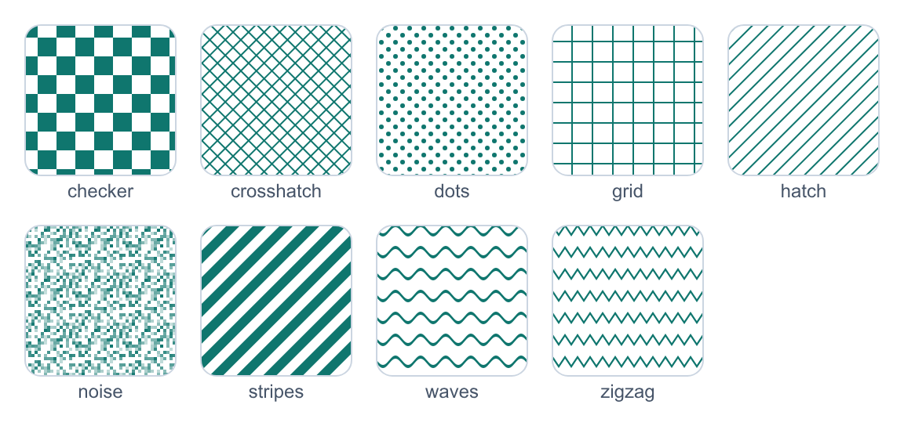
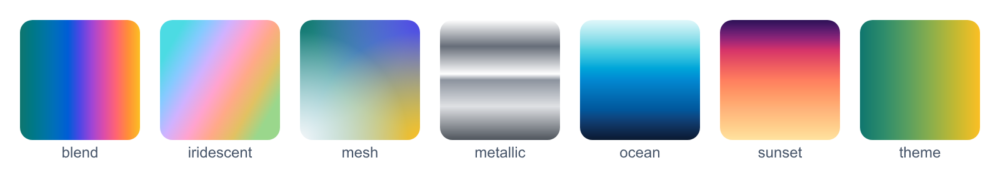
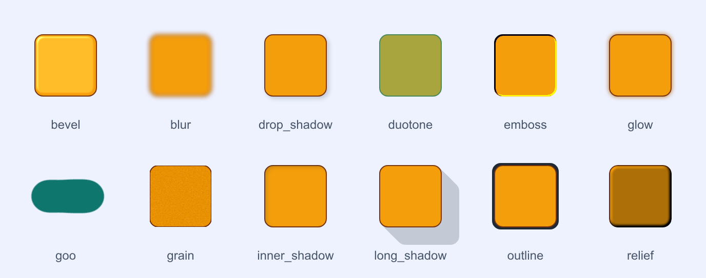
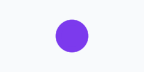
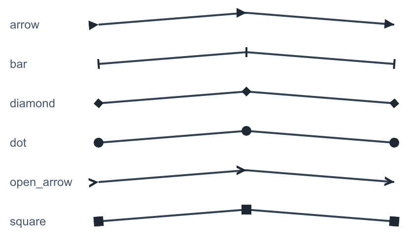
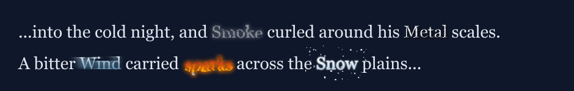

# Presets

svgwriter ships catalogues of ready-made looks: patterns and gradients to paint with, filters, line
markers and effects. Each catalogue is a module of functions that build an ordinary element, so the
result is plain SVG you can inspect and edit, and each is open to presets of your own.

| Catalogue | Use it as | Builds |
| --- | --- | --- |
| `svg.patterns` | `fill=svg.patterns.hatch()` | `<pattern>` |
| `svg.gradients` | `fill=svg.gradients.sunset()` | `<linearGradient>`, `<radialGradient>` or a `<pattern>` of blends |
| `svg.filters` | `el.filter = svg.filters.glow(4)` | `<filter>` |
| `svg.markers` | `marker_end=svg.markers.arrow()` | `<marker>` |
| `svg.effects` | `shape.effect("neon")`, `text[4:9].effect("fire")` | paint, a filter and an animation on any element, text staying text |

Every definition goes into the document's `<defs>` when an element refers to it; you never add it there
yourself. The singular names (`svg.pattern`, `svg.filter`, `svg.marker`) stay the element classes; the
plural catalogues hold the ready-made ones, and `svg.preset.<kind>` registers your own.

## Patterns

```python
import svgwriter as svg

doc = svg.Document(220, 80)
doc.rect(10, 10, 60, 60, fill=svg.patterns.stripes(angle=45, gap=6))
doc.rect(80, 10, 60, 60, fill=svg.patterns.dots(gap=5, color="crimson", background="mistyrose"))
doc.rect(150, 10, 60, 60, fill=svg.patterns.noise(seed=7, density=0.4))
```



Patterns are in user units, so stripes keep their spacing on any shape. Without `color=` the shapes take
the theme role `pattern` (the palette's primary color) and follow the document theme; `role=` picks
another role and `background=` fills behind. `noise` is seeded: equal seeds give equal tiles.

## Gradients

```python
sky = svg.gradients.sunset()
brand = svg.gradients.theme()                    # primary to accent of the current theme
heat = svg.gradients.blend("navy", "crimson", "gold", angle=90)
```



A blend between distant colors in sRGB, the space SVG interpolates in, turns grey in the middle. The
gradient presets sample extra stops in OKLCH, so `blend("red", "blue")` passes through a clear violet.
`angle=` sets the direction (0 left to right, 90 top to bottom). Gradients are in bounding-box units and
stretch to the shape; `mesh` layers a radial blend from each corner. Stop colors are numbers, so theme
defaults come from the current theme when the gradient is built (`with svg.themes.get("dark"):`).

## Filters

```python
card = doc.rect(10, 10, 60, 40, rx=6, fill="white")
card.filter = svg.filters.drop_shadow(2, 3, 3)

with doc.group(fill="teal") as blobs:
    doc.circle(30, 60, 12)
    doc.circle(52, 60, 12)
blobs.filter = svg.filters.goo()                 # the circles melt together
```



Filter regions are enlarged so blurs and shadows are not clipped, and colors are computed in sRGB.
Shadows and outlines take their `flood-color` from the theme roles `filter.shadow` and `filter.ink` unless
you pass a color, so they restyle with the document theme. `bevel` and `relief` are lighting presets;
`duotone` maps brightness onto two colors; `grain` mixes seeded noise into the shape.



## Markers

```python
doc.path("M10 70 L110 20 L210 70", fill="none", stroke="black", stroke_width=2,
         marker_start=svg.markers.dot(), marker_mid=svg.markers.diamond(), marker_end=svg.markers.arrow())
```



Markers are sized in stroke widths, so a thicker line gets a larger head, and turn with the line
(`orient="auto"`). They take the theme role `arrow.head` unless you pass `color=`.

## Effects

```python
doc = svg.Document(520, 60)
line = doc.text("A bitter Wind carried sparks", x=10, y=40, font_size=28)
line[9:13].effect("wind")
svg.effects.fire(line[22:28])               # the same, by function
doc.save("sparks.gif")
```



`fire`, `ice`, `smoke`, `metal`, `wind`, `snow`, `neon` and `glitch` each set a gradient or color, a
filter and a small SMIL animation (`animate=False` leaves it still), on any element: a shape, group, image
or text (`svg.circle(0, 0, 20).effect("neon")`). The glyphs of a text are never turned into outlines: the
text stays selectable and searchable, and keeps its font. Effects size themselves to the element (a text to
its glyph height, anything else to the shorter side of its bounding box), so the same effect looks the same
at any size.

On a whole text the effect styles it directly. On a range the characters move onto a copy of the text
placed just above it (`text[a:b].isolate()`): the copy hides every other character and the original
hides the range, both with `visibility="hidden"` so every character keeps its place. Filters then reach
exactly the range. The text has to be in a document or group first, so the copy has somewhere to go.

## Exporting

Every preset renders to PNG and the raster formats through skia, and animated ones to GIF and video.
PDF keeps patterns, gradients, markers and text and draws filtered elements as images. PowerPoint keeps
patterns, gradients, markers and the text itself, and skips filters and the filter animations with a
warning naming them.

## Presets of your own

Each catalogue has a decorator. The function joins its catalogue under its name (or `name=`), a taken
name raises an error naming its owner, and `replace=True` replaces one on purpose, a built-in included.
The wrapper checks the return type, so a mistake fails where it is made.

```python
@svg.preset.pattern
def bricks(*, size: float = 12, color: str = "firebrick") -> svg.Pattern:
    mortar = svg.rect(0, 0, size, size / 2, fill=color, stroke="white")
    return svg.Pattern(mortar, width=size, height=size / 2, pattern_units="userSpaceOnUse")


@svg.preset.effect
def ember(element: svg.Element, *, color: str = "#f97316") -> None:
    element.fill = svg.gradients.blend("#fde68a", color, "#7f1d1d", angle=-90)
    element.filter = svg.filters.glow(3, color=color)


wall = svg.rect(0, 0, 60, 30, fill=svg.patterns.bricks())
title = svg.Document(200, 50).text("still warm", x=10, y=36, font_size=28)
title[6:].effect("ember")
svg.preset.pattern.unregister("bricks")
svg.preset.effect.unregister("ember")
```

An effect receives the element (for a range, the copy holding the range's characters) and styles it in
place; registering it makes it work on every element and on ranges. An effect that only suits some
elements raises `TypeError` for the others. `svg.preset.filter.list()` lists a catalogue and `svg.preset.marker.get("arrow")` looks one up
by name. The functions are documented in the [preset reference](../reference/presets.md); packages can ship presets
through entry points (see [Extending svgwriter](extending.md)).
